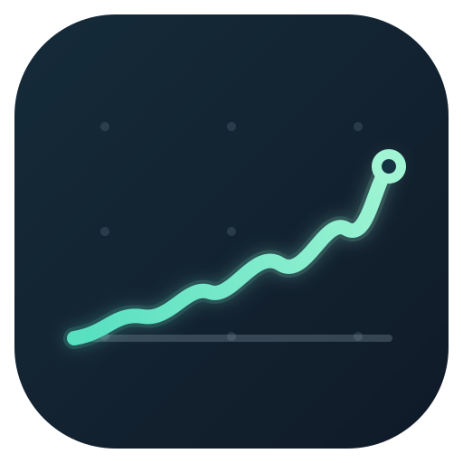
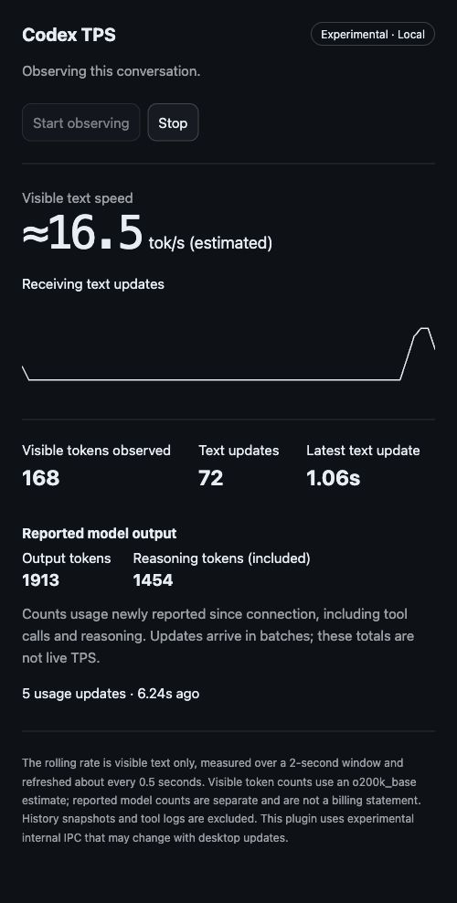

<p align="center">
  
</p>

<h1 align="center">Codex TPS</h1>

<p align="center">Live visible-text speed and reported model output for Codex Desktop on macOS.</p>

<p align="center">
  
</p>

<p align="center"><em>Live browser preview connected to Codex Desktop IPC; not a native Codex window capture. This sample shows about 16.5 tok/s, 72 text updates, and 1,913 reported output tokens, including 1,454 reasoning tokens.</em></p>

Codex TPS adds a conversation panel that observes the current conversation, plus an optional terminal watcher. It estimates visible text speed and separately displays the desktop's reported output usage, which includes tool calls and reasoning.

## Trust Tibo. Verify tok/s.

<p align="center">
  <a href="https://codex-tibo.codes/">
    
  </a>
</p>

<p align="center"><em>Saint Tibo, giver of tokens, resetter of limits. Community meme via the <a href="https://codex-tibo.codes/">Saint Tibo fan archive</a>.</em></p>

Built for the moment Codex starts typing like it's paid by the hour and the group chat asks: **"Tibo, did you touch the speed dial?"**

We're grateful for the resets. We'd just like to know whether our tokens are arriving by bicycle. So we put a speedometer on the stream.

The graph shows observed visible-text speed. It can't prove throttling or tell us who touched the dial. Unofficial project; no affiliation with OpenAI or Tibo.

## Requirements

- macOS with Codex Desktop installed and signed in.
- The `codex` CLI on `PATH`, with `codex plugin --help` available. The installation commands were checked with CLI 0.154.0.
- [`uv`](https://docs.astral.sh/uv/getting-started/installation/) installed and available on `PATH`. The plugin uses it to launch its local MCP server and fetch the tokenizer dependency.
- A local Codex conversation open when you start observing it.

Codex TPS reads the local Codex IPC socket and conversation index. It does not work in web-only Codex sessions or on Windows/Linux. The first launch may download `tiktoken` and its vocabulary through `uv`.

## Install the Codex Desktop plugin

Install the plugin directly from its GitHub marketplace without cloning it:

```sh
codex plugin marketplace add return2faye/codex-tps
codex plugin add codex-tps@codex-tps-dev
```

The marketplace ID is `codex-tps-dev`. These commands use Codex's supported GitHub marketplace source and plugin selector syntax. See OpenAI's [plugin packaging and marketplace guide](https://developers.openai.com/plugins/build/plugins).

After installation, reload plugins in Codex Desktop or restart the app. Open a conversation and choose **Codex TPS** from its content tabs, or invoke `codex_tps_open`. The panel starts observing that conversation automatically. Use **Stop** to pause and **Start observing** to resume.

The panel uses the conversation context supplied by Codex. It does not guess based on the active window or most recent conversation. Missing context is reported as an error.

### Update or uninstall

To fetch the latest marketplace and plugin version, run:

```sh
codex plugin marketplace upgrade codex-tps-dev
codex plugin add codex-tps@codex-tps-dev
```

Then reload plugins or restart Codex Desktop. To uninstall the plugin:

```sh
codex plugin remove codex-tps@codex-tps-dev
```

To remove the GitHub marketplace source too:

```sh
codex plugin marketplace remove codex-tps-dev
```

## Optional terminal watcher

The plugin and terminal watcher share the same measurement code. The watcher can list recent conversations or follow one by ID:

```sh
codex-tps threads
codex-tps watch --thread <conversation-uuid>
```

It refreshes every 500 ms, waits up to 10 seconds for the first IPC snapshot, and returns to zero during idle periods. Press Ctrl-C to stop. Add `--json` for machine-readable output.

To install the shell command from a source checkout, use the local installer instead of the GitHub marketplace flow:

```sh
git clone https://github.com/return2faye/codex-tps.git
cd codex-tps
uv run --no-project --python 3.11 install.py
```

The installer registers the checkout as a **local** marketplace named `codex-tps-dev`, installs the plugin from that checkout, and places a `codex-tps` wrapper in `~/.local/bin`. Choose this checkout-based setup or the remote GitHub marketplace setup above; do not register both under the same marketplace name. uv manages Python for this command, so no manual virtual environment setup is needed.

If `~/.local/bin` is not on your shell's `PATH`, add:

```sh
export PATH="$HOME/.local/bin:$PATH"
```

To update a checkout-based installation, run `git pull --ff-only` in the checkout and rerun the installer command above. Keep the checkout in place as the local marketplace source; the shell wrapper launches the installed plugin copy. The installer refuses to replace an unrelated existing command or symlink. After uninstalling, you can remove `~/.local/bin/codex-tps` if its header contains `# codex-tps installer managed wrapper`.

For a dependency-free command-line fallback, run the server directly with Python:

```sh
python3 plugins/codex-tps/server.py threads
python3 plugins/codex-tps/server.py watch --thread <conversation-uuid>
```

Python 3.11+ is recommended for this path. Without a working `tiktoken` install, character speed remains available while token speed is reported as unavailable.

## What the numbers mean

**Visible-text TPS** estimates net token growth in visible assistant replies and plan text over a rolling two-second window. It excludes history, user input, tool output, and reasoning. Text may be revised as it streams, and tokenizer estimates can differ from the model's internal tokenization.

**Reported output tokens** come from Codex Desktop's usage counters. They include generated tool calls and reasoning; reasoning tokens are already included in the output total. Updates arrive in batches, separate from visible-text updates. The initial snapshot establishes a history baseline, and resets or missing usage create a new baseline with the gap excluded. If monitoring begins during an active request, a later usage update may include output generated before monitoring started.

These are local estimates and client-reported counters, not server decoding speed or a billing statement. The internal Codex IPC protocol is unsupported and may change across app versions.

## Verification

The latest local verification includes:

| Check | Result |
| --- | --- |
| Server unit tests | 16 passed |
| Installer tests | 5 passed |
| Dashboard JavaScript mock-host test | Passed |
| Installed MCP service and CLI usage | Both received 2,577 reported output tokens, including 914 reasoning tokens, over 45 seconds; clean exits |
| Live visible-text stream | 171 text patches and 900 characters observed during generation; median patch interval about 72 ms |

The browser preview shows real data from Codex Desktop IPC. Native desktop rendering was confirmed for 0.1.1; the current 0.1.4 panel and icon still need native visual confirmation. Installation from a local checkout passed; installation from the public GitHub repository has not yet been tested. See [SESSION.md](SESSION.md) for detailed evidence, version notes, and known limitations.

## Troubleshooting

- **`uv` not found:** install uv and ensure it is available on `PATH`, then restart Codex Desktop.
- **No initial snapshot:** make sure the target conversation is open in the local desktop app. If it is open, restart Codex Desktop normally and retry. The first snapshot can take up to 10 seconds.
- **Socket permission error:** Codex TPS respects the existing IPC socket permissions. Do not change app security settings or patch the application to force access.
- **Token speed unavailable:** visible character speed can still work. Check that `uv` can download and run `tiktoken` if token estimates are needed.

## Privacy

Conversation metadata is read from the local SQLite index in read-only mode. Reply text stays in memory for measurement and is not saved or sent to a third party. The plugin does not read credentials or modify Codex Desktop files.

## License

[MIT](LICENSE)
